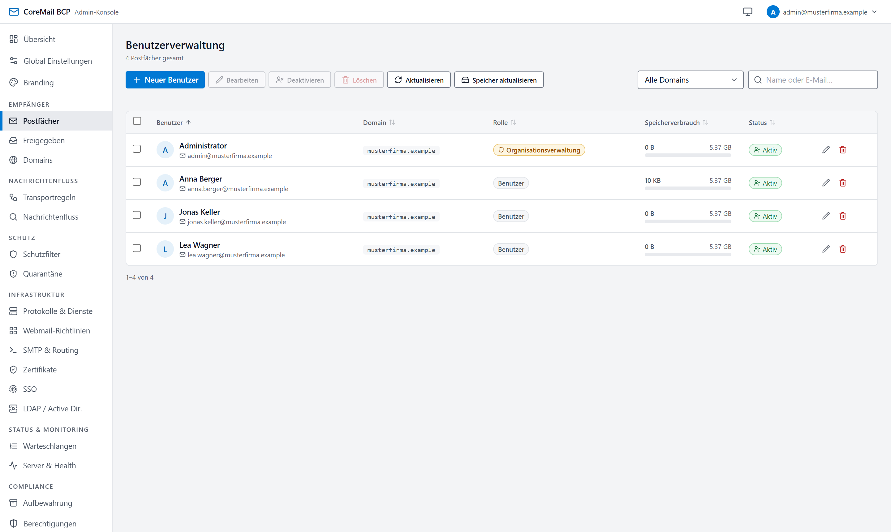

<p align="center">
  
</p>

<h1 align="center">CoreMail</h1>

<p align="center">
  <a href="https://github.com/MAGPEEK/CoreMail/releases"></a>
  <a href="https://hub.docker.com/r/magpeek/coremail-app"></a>
  <a href="LICENSE"></a>
</p>

<p align="center">
  Dein eigener Mailserver mit Webmail, Kalender und Kontakten, in einem Docker-Image.
</p>

<p align="center">
  <a href="#schnellstart">Schnellstart</a> ·
  <a href="docs/">Dokumentation</a> ·
  <a href="CHANGELOG.md">Changelog</a> ·
  <a href="docs/version-history.de.md">Versionshistorie</a> ·
  <a href="https://github.com/MAGPEEK/CoreMail/releases">Releases</a> ·
  <a href="https://hub.docker.com/r/magpeek/coremail-app">Docker Hub</a>
</p>

<p align="center">
  🇬🇧 <a href="README.md">English version</a> · 🇩🇪 Deutsche Fassung
</p>

<table>
  <tr>
    <td width="50%" align="center"><br><sub>Webmail</sub></td>
    <td width="50%" align="center"><br><sub>Admin-Panel (BCP)</sub></td>
  </tr>
</table>

## Was ist CoreMail?

CoreMail ist ein selbst gehosteter Open-Source-Mailserver. Er bringt ein vollständiges Webmail mit (Mail, Kalender, Kontakte, Aufgaben, Notizen) und ein Admin-Panel (BCP) für Benutzer, Domains, Sicherheit und Zertifikate. Alles läuft in einem Docker-Image neben PostgreSQL und Redis. Desktop-Mailprogramme verbinden sich über MAPI over HTTP oder IMAP, Telefone über ActiveSync, Apple Mail, Thunderbird und andere Apps über IMAP, SMTP, CalDAV/CardDAV oder JMAP.

## Für wen ist CoreMail?

- Kleine und mittlere Unternehmen mit 10–500 Postfächern, die ihre Mails auf dem eigenen Server haben wollen.
- Selfhoster und Homelabs mit eigener Domain.
- IT-Dienstleister, die mehrere Kundendomains auf einem Server betreiben, mit Admins, die nur ihre eigenen Domains sehen.
- Teams, die Desktop-Clients, Telefone und das Webmail mit demselben Postfach nutzen.

Nicht gedacht ist CoreMail für große Anbieter mit Tausenden Postfächern auf einem Host.

## Funktionen

- **Protokolle:** SMTP (25, 465, 587), IMAP4rev2, POP3, JMAP, ActiveSync 12.1–14.1, CalDAV/CardDAV, Autodiscover und automatische Einrichtung für Thunderbird und Apple-Geräte.
- **Desktop-Clients:** MAPI over HTTP für Mail (Online- und zwischengespeicherter Modus; Opt-in, [docs/mapi.md](docs/mapi.md)), Kalender und Kontakte über CalDAV/CardDAV.
- **Telefone:** ActiveSync synchronisiert Mail, Kalender, Kontakte, Aufgaben und Notizen in beide Richtungen (iOS, Android).
- **Webmail:** Mail, Kalender mit Serienterminen, Kontakte und Kontaktlisten, Aufgaben mit Nachverfolgungs-Flags, Notizen, freigegebene Postfächer, Ordnerberechtigungen, Regeln, Abwesenheitsnotiz, Suche.
- **Mail-Sicherheit:** SPF, DKIM (Signieren und Prüfen), DMARC, ARC, DNSBL, Greylisting, Anhangfilter, Quarantäne; rspamd-Spambewertung und ClamAV-Virenscan als optionale Container.
- **Anmeldung:** Zwei-Faktor-Authentifizierung (TOTP, WebAuthn, Backup-Codes), App-Passwörter für Mail-Apps, SSO über OIDC, LDAP / Active Directory, Sperre bei Brute-Force-Versuchen.
- **Zertifikate:** Let's Encrypt eingebaut, mit automatischer Verlängerung und eingebautem HTTPS-Proxy.
- **Sicherungen:** verschlüsselte Postfach- und Datenbanksicherungen mit Wiederherstellung im Admin-Panel.
- **Verwaltung:** Admin-Rollen, die sich auf Domains beschränken lassen, Audit-Log, Nachrichtenablaufverfolgung, Warteschlangen, Protokollschalter pro Domain und Postfach, Admin-CLI `coremail` und eine MCP-Schnittstelle für KI-Assistenten und MCP-Clients (ab Werk aus, [docs/mcp.md](docs/mcp.md)).
- **Betrieb:** eigenes Branding (Name, Farben, Logo), Docker-Compose-Varianten von minimal bis voll, Helm-Chart für Kubernetes.

## Schnellstart

Du brauchst einen Linux-Server mit Docker 24 oder neuer und Docker Compose 2.20 oder neuer. Kein Klonen des Repositorys und keine Konfigurationsdatei: eine Compose-Datei aus dem Release, und CoreMail erzeugt beim ersten Start alle Geheimnisse (Schlüssel und Datenbank-Passwörter).

```bash
mkdir coremail && cd coremail
curl -fsSLO https://github.com/MAGPEEK/CoreMail/releases/latest/download/docker-compose.yml
docker compose up -d
```

Danach öffnest du `http://<server-ip>:3000/setup`; das einmalige Setup-Token steht in `./secrets/setup-token` ([Erste Anmeldung](#erste-anmeldung)). **Sichere `./secrets/` außerhalb des Servers** — ohne `PEPPER` aus `coremail.env` funktioniert kein Passwort mehr.

Der Standard-Stack besteht aus CoreMail, PostgreSQL und Redis — passt für bis zu etwa 50 Benutzer mit 2 GB RAM. SPF, DKIM, DMARC, DNSBL und Greylisting laufen immer. Optionale Dienste sind Compose-Profile (`docker compose --profile scanner up -d` oder `COMPOSE_PROFILES=scanner,backup` in einer `.env` neben der Datei):

| Profil | Ergänzt |
|--------|---------|
| `scanner` | rspamd (Spam-Bewertung) und ClamAV (Virenscan), etwa 1,5 GB RAM mehr — wird automatisch erkannt |
| `backup` | täglicher `pg_dump` der Datenbank ins Volume `pg-backups` |
| `s3` | MinIO als Ziel des eingebauten Sicherungsdienstes (die Mails bleiben auf dem Volume `coremail-data`) |

Alles zu dieser Datei — Ports, DNS, Sicherung, eigene Einstellungen, Deinstallation: [docs/deploy.md](docs/deploy.md) (englisch).

**Fortgeschritten:** [weitere Compose-Varianten](docs/docker-compose.md) (Repository-Checkout, bestehende Installationen) · [reines `docker run`](docs/deploy.md#docker-run) · [Synology](docs/deployment-docker.md#synology-nas) · [Kubernetes-Helm-Chart](infra/k8s/README.md)

### Erste Anmeldung

1. Warte etwa eine Minute, bis der Container gesund ist (`docker compose ps` zeigt `healthy`).
2. Lies das einmalige Setup-Token aus: `./secrets/setup-token` — oder `docker exec coremail cat /secrets/setup-token`.
3. Öffne `http://<server-ip>:3000/setup` und gib das Token, deine Mail-Domain, die erste Admin-Adresse und ein Passwort ein.
4. Trage im Admin-Panel die DNS-Einträge aus **Domains** ein, fordere das Let's-Encrypt-Zertifikat über die Dashboard-Karte **Zertifikat einrichten** (oder unter **Zertifikate**) an und lege die Postfächer an. Das Webmail erreichst du unter `https://<dein-host>/`, das Admin-Panel unter `https://<dein-host>/bcp/`.
5. Sichere das Verzeichnis `secrets` außerhalb des Servers (Passwortmanager, Offline-Kopie) — der Einrichtungsassistent bietet `coremail.env` zum Download an.

| Port | Zweck |
|------|-------|
| 80 → 3000 | HTTP: Let's Encrypt und Weiterleitung auf HTTPS |
| 443 | HTTPS: Webmail, Admin-Panel, ActiveSync, MAPI, CalDAV/CardDAV, JMAP |
| 3000 | HTTP ohne TLS: Ersteinrichtung oder hinter deinem eigenen Reverse Proxy |
| 25 | SMTP von anderen Mailservern |
| 465 / 587 | SMTP-Versand für Mail-Apps (implizites TLS / STARTTLS) |
| 993 / 143 | IMAP (implizites TLS / STARTTLS) |
| 995 / 110 | POP3, optional (implizites TLS / STLS) |

**DNS:** Richte einen A-Record und den MX-Record auf den Server und ergänze SPF, DKIM und DMARC; das Admin-Panel zeigt die genauen Einträge pro Domain unter **Domains** und prüft sie live.

## Aktualisieren

```bash
docker compose pull && docker compose up -d --remove-orphans
```

Update von 10.4.0: `--remove-orphans` entfernt einmalig den gestoppten Init-Container dieser Version. Die Compose-Datei nennt das Image ihres Releases; für ein neues Release lädst du zuerst die neue Datei ([docs/deploy.md → Update](docs/deploy.md#update)). Mit einer anderen Compose-Variante nimmst du deren Datei (`docker compose -f infra/docker/docker-compose.yml pull && docker compose -f infra/docker/docker-compose.yml up -d --remove-orphans`). Das Datenbankschema wird beim Start aktualisiert.

Upgrade von einer älteren Version: lies vorher die [Versionshistorie](docs/version-history.de.md) und die [Release-Notes](docs/releases/).

## Dokumentation

- [Installation mit einer Compose-Datei](docs/deploy.md): Profile, eigene Einstellungen, Sicherung, Update
- [Docker-Compose-Varianten, Speicher und Sicherungen](docs/docker-compose.md)
- [Docker-Betrieb](docs/deployment-docker.md) und [Sicherheitshärtung](docs/deployment-security.md)
- [Client-Einrichtung](docs/clients.md): Desktop-Clients ([MAPI over HTTP](docs/mapi.md)), Telefone ([ActiveSync](docs/activesync.md)), Thunderbird und Apple
- [Zertifikate und Let's Encrypt](docs/certificates.md)
- [Sicherung und Wiederherstellung](docs/backup.md)
- [Admin-Rollen](docs/rbac.md), [Branding](docs/branding.md), [Admin-CLI](docs/cli.md)
- [Selbstregistrierung](docs/self-registration.md): Benutzer legen ihr Postfach selbst an (standardmäßig aus)
- [MCP-Schnittstelle für Admins](docs/mcp.md): den Server mit einem MCP-Client verwalten
- [Kubernetes-Helm-Chart](infra/k8s/README.md)
- [Versionshistorie](docs/version-history.de.md) und [Changelog](CHANGELOG.md)
- Alle Dokumente (englisch): [docs/](docs/)

## Support

Einen Fehler gefunden oder fehlt dir eine Funktion? Eröffne ein Issue auf [GitHub](https://github.com/MAGPEEK/CoreMail/issues).

## Lizenz

MIT — siehe [LICENSE](LICENSE).
