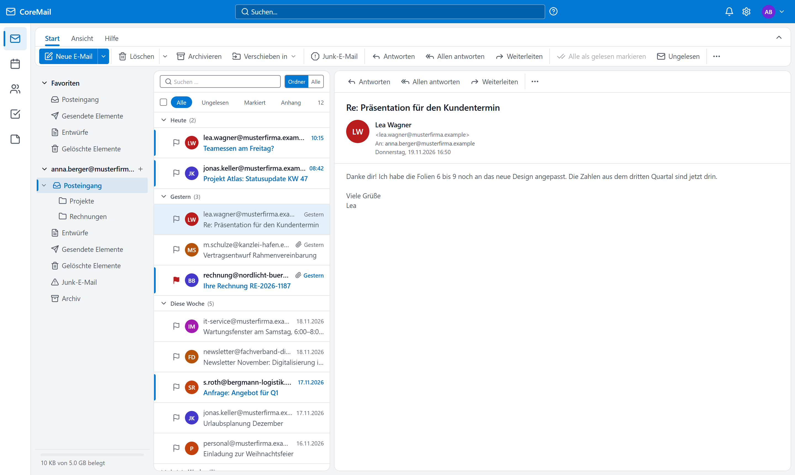
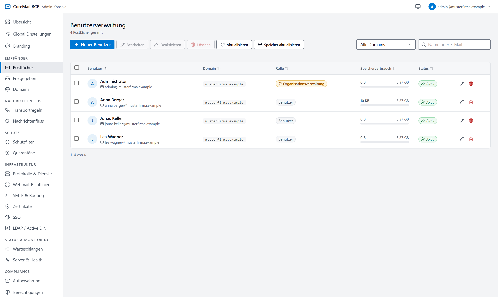

<p align="center">
  
</p>

<h1 align="center">CoreMail</h1>

<p align="center">
  <a href="https://github.com/MAGPEEK/CoreMail/releases"></a>
  <a href="https://hub.docker.com/r/magpeek/coremail-app"></a>
  <a href="LICENSE"></a>
</p>

<p align="center">
  Your own mail server with webmail, calendar and contacts, in one Docker image.
</p>

<p align="center">
  <a href="#quick-start">Quick start</a> ·
  <a href="docs/">Documentation</a> ·
  <a href="CHANGELOG.md">Changelog</a> ·
  <a href="docs/version-history.md">Version history</a> ·
  <a href="https://github.com/MAGPEEK/CoreMail/releases">Releases</a> ·
  <a href="https://hub.docker.com/r/magpeek/coremail-app">Docker Hub</a>
</p>

<p align="center">
  🇬🇧 English · 🇩🇪 <a href="README.de.md">Deutsche Fassung</a>
</p>

<table>
  <tr>
    <td width="50%" align="center"><br><sub>Webmail</sub></td>
    <td width="50%" align="center"><br><sub>Admin panel (BCP)</sub></td>
  </tr>
</table>

## What is CoreMail?

CoreMail is a self-hosted, open-source mail server. It comes with a full webmail (mail, calendar, contacts, tasks, notes) and an admin panel (BCP) for users, domains, security and certificates. Everything runs in one Docker image next to PostgreSQL and Redis. Desktop mail clients connect via MAPI over HTTP or IMAP, phones via ActiveSync, and Apple Mail, Thunderbird and other apps via IMAP, SMTP, CalDAV/CardDAV or JMAP.

## Who is it for?

- Small and medium businesses with 10–500 mailboxes that want their mail on their own server.
- Self-hosters and home labs with their own domain.
- IT service providers that host several customer domains on one server, with admins limited to their own domains.
- Teams that use desktop clients, phones and the webmail on the same mailbox.

It is not built for large providers with thousands of mailboxes on one host.

## Features

- **Protocols:** SMTP (25, 465, 587), IMAP4rev2, POP3, JMAP, ActiveSync 12.1–14.1, CalDAV/CardDAV, Autodiscover and automatic setup for Thunderbird and Apple devices.
- **Desktop clients:** MAPI over HTTP for mail (online and cached mode; opt-in, [docs/mapi.md](docs/mapi.md)), calendar and contacts via CalDAV/CardDAV.
- **Phones:** ActiveSync syncs mail, calendar, contacts, tasks and notes both ways (iOS, Android).
- **Webmail:** mail, calendar with recurring events, contacts and contact groups, tasks with follow-up flags, notes, shared mailboxes, folder permissions, rules, out-of-office, search.
- **Mail security:** SPF, DKIM (signing and checking), DMARC, ARC, DNSBL, greylisting, attachment filter, quarantine; rspamd spam scoring and ClamAV virus scanning as optional containers.
- **Sign-in:** two-factor authentication (TOTP, WebAuthn, backup codes), app passwords for mail apps, SSO via OIDC, LDAP / Active Directory, brute-force lockout.
- **Certificates:** Let's Encrypt built in, with automatic renewal and a built-in HTTPS proxy.
- **Backups:** encrypted mailbox and database backups with restore from the admin panel.
- **Administration:** admin roles that can be limited to domains, audit log, message trace, queue management, per-domain and per-mailbox protocol switches, admin CLI `coremail`, and an MCP interface for AI assistants and MCP clients (off by default, [docs/mcp.md](docs/mcp.md)).
- **Operation:** your own branding (name, colours, logo), Docker Compose variants from minimal to full, Helm chart for Kubernetes.

## Quick start

You need a Linux server with Docker 24 or newer and Docker Compose 2.20 or newer. No repository checkout and no configuration file: one Compose file from the release, and CoreMail generates every secret (keys and database passwords) on the first start.

```bash
mkdir coremail && cd coremail
curl -fsSLO https://github.com/MAGPEEK/CoreMail/releases/latest/download/docker-compose.yml
docker compose up -d
```

Then open `http://<server-ip>:3000/setup`; the one-time setup token is in `./secrets/setup-token` ([First login](#first-login)). **Back up `./secrets/` off the server** — without `PEPPER` from `coremail.env` no password works anymore.

The default stack is CoreMail, PostgreSQL and Redis — good for up to about 50 users on 2 GB RAM. SPF, DKIM, DMARC, DNSBL and greylisting always run. Optional services are Compose profiles (`docker compose --profile scanner up -d`, or `COMPOSE_PROFILES=scanner,backup` in a `.env` next to the file):

| Profile | Adds |
|---------|------|
| `scanner` | rspamd (spam scoring) and ClamAV (virus scanning), about 1.5 GB RAM more — picked up automatically |
| `backup` | a daily `pg_dump` of the database into the volume `pg-backups` |
| `s3` | MinIO as the target of the built-in backup service (mail stays on the `coremail-data` volume) |

Everything about this file — ports, DNS, backups, overrides, uninstall: [docs/deploy.md](docs/deploy.md).

**Advanced:** [other Compose variants](docs/docker-compose.md) (repository checkout, existing installations) · [plain `docker run`](docs/deploy.md#docker-run) · [Synology](docs/deployment-docker.md#synology-nas) · [Kubernetes Helm chart](infra/k8s/README.md)

### First login

1. Wait about a minute until the container is healthy (`docker compose ps` shows `healthy`).
2. Read the one-time setup token: `./secrets/setup-token` — or `docker exec coremail cat /secrets/setup-token`.
3. Open `http://<server-ip>:3000/setup`, enter the token, your mail domain, the first admin address and a password.
4. In the admin panel, enter the DNS records shown under **Domains**, request the Let's Encrypt certificate with the dashboard card **Zertifikat einrichten** (or under **Certificates**) and create the mailboxes. The webmail is at `https://<your-host>/`, the admin panel at `https://<your-host>/bcp/`.
5. Back up the `secrets` directory off the server (password manager, offline copy) — the setup wizard offers `coremail.env` as a download.

| Port | Use |
|------|-----|
| 80 → 3000 | HTTP: Let's Encrypt and redirect to HTTPS |
| 443 | HTTPS: webmail, admin panel, ActiveSync, MAPI, CalDAV/CardDAV, JMAP |
| 3000 | HTTP without TLS: first setup, or behind your own reverse proxy |
| 25 | SMTP from other mail servers |
| 465 / 587 | SMTP submission for mail apps (implicit TLS / STARTTLS) |
| 993 / 143 | IMAP (implicit TLS / STARTTLS) |
| 995 / 110 | POP3, optional (implicit TLS / STLS) |

**DNS:** point an A record and the MX record at the server and add SPF, DKIM and DMARC; the admin panel shows the exact records for each domain under **Domains** and checks them live.

## Update

```bash
docker compose pull && docker compose up -d --remove-orphans
```

Updating from 10.4.0: `--remove-orphans` removes its stopped init container once. The Compose file names the image of its release; for a new release download the new file first ([docs/deploy.md → Update](docs/deploy.md#update)). With another Compose variant use its file (`docker compose -f infra/docker/docker-compose.yml pull && docker compose -f infra/docker/docker-compose.yml up -d --remove-orphans`). The database schema is updated at start.

Upgrading from an older version: read the [version history](docs/version-history.md) and the [release notes](docs/releases/) first.

## Documentation

- [Deployment with one Compose file](docs/deploy.md): profiles, overrides, backup, update
- [Docker Compose variants, storage and backups](docs/docker-compose.md)
- [Docker operation](docs/deployment-docker.md) and [security hardening](docs/deployment-security.md)
- [Client setup](docs/clients.md): desktop clients ([MAPI over HTTP](docs/mapi.md)), phones ([ActiveSync](docs/activesync.md)), Thunderbird and Apple
- [Certificates and Let's Encrypt](docs/certificates.md)
- [Backup and restore](docs/backup.md)
- [Admin roles](docs/rbac.md), [branding](docs/branding.md), [admin CLI](docs/cli.md)
- [Self-registration](docs/self-registration.md): users create their own mailbox (off by default)
- [MCP interface for administrators](docs/mcp.md): manage the server with an MCP client
- [Kubernetes Helm chart](infra/k8s/README.md)
- [Version history](docs/version-history.md) and [changelog](CHANGELOG.md)
- All documents: [docs/](docs/)

## Support

Found a bug or missing a feature? Open an issue on [GitHub](https://github.com/MAGPEEK/CoreMail/issues).

## License

MIT — see [LICENSE](LICENSE).
